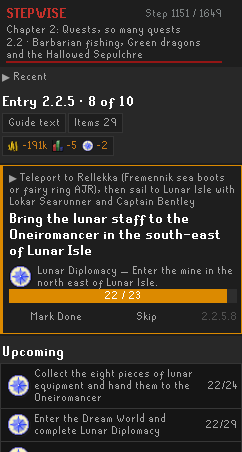
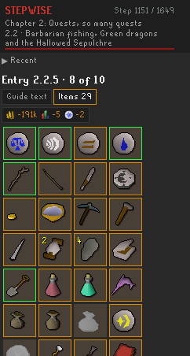
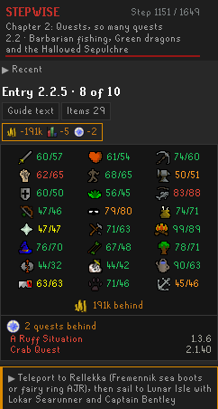
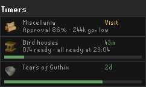

# Stepwise: Unofficial BRUHsailer Guide

**Iron guide, step by step.**

Stepwise follows the BRUHsailer Ironman guide by So Iron BRUH and ParasailerOSRS. It checks
steps off as the game shows you did them, finds your place in the route on your first login,
and shows the route's timers in the same panel as your current step.

> **Stepwise is unofficial.** The BRUHsailer guide's authors did not make this plugin and do
> not maintain it. For the guide itself, read the
> [original guide](https://docs.google.com/document/d/1CBkFM70SnrW4hJXvHM2F1fYCuBF_fRnEXnTYgRnRkAE).
> Report problems with Stepwise on its
> [GitHub issue tracker](https://github.com/agrahamlincoln/stepwise-plugin/issues), not to the
> guide's authors.

Stepwise makes no network requests. A link in the panel opens in your browser only when you
click it.

## Current step

The panel shows the step you are on and the ones around it.

- Steps check themselves off from quest progress, items, skill levels, diary and combat tasks,
  places reached and furniture you build.
- Mark Done, Skip and Undo cover anything the game cannot show.
- An optional in-game overlay shows the current step. Turn it off in the settings.
- When an XP lamp, tome or book asks you to choose a skill, the skill the guide recommends is
  outlined. Turn it off in the settings.
- Turn on the Step Complete notification to be told when a game event finishes your current step.
  Expand the setting to choose how it reaches you. By default RuneLite sends nothing while
  the game window has focus.

## Items needed

The guide's item list for your stretch appears as an inventory grid.

- Green border: you carry it. Orange border: it is in your bank. Dimmed icon: you do not have it.
- Open your bank once so Stepwise can see it. It keeps what it saw between sessions.

## Route check

Click the GP, skills, quests and diary chip under the entry title to compare your account with
the route.

- Every skill and your GP against the levels and money the guide expects at this entry.
- The quests the guide has you finish before here that you have not.
- The achievement diary tasks the guide has you do before here that you have not.

## Timers

Bird houses, Tears of Guthix and Miscellania count down in the panel.

- A bird house InfoBox counts down your run. Hide it in the settings.
- Logged out, the panel shows your last account's step, its progress through the guide and
  its timers.

## How to use

1. Install Stepwise from the Plugin Hub and open its icon in the RuneLite sidebar.
2. Log in. On a first login Stepwise moves you to the furthest point of the route you have
   cleared.
3. Play. Follow the current step. Open your bank once so the items grid can check it.
4. Use Mark Done or Skip when a step has no game signal.

Progress saves to your RuneLite profile for each account.

## Credits

- **The BRUHsailer Ironman guide** by So Iron BRUH and ParasailerOSRS
  ([original guide](https://docs.google.com/document/d/1CBkFM70SnrW4hJXvHM2F1fYCuBF_fRnEXnTYgRnRkAE),
  [interactive guide](https://umkyzn.github.io/BRUHsailer/),
  [wiki page](https://oldschool.runescape.wiki/w/Guide:BRUHsailer)). Stepwise follows their
  route and shows their text for each entry. Stepwise is not an official BRUHsailer plugin.
- **[Quest Helper](https://github.com/Zoinkwiz/quest-helper)** by Zoinkwiz and its
  contributors, for quest stage data and quest var ids.
- **[RuneLite](https://github.com/runelite/runelite)**, whose Time Tracking plugin code
  Stepwise's bird house tracking is derived from, and whose Varbits table supplies diary varbit
  ids.
- **The [Old School RuneScape Wiki](https://oldschool.runescape.wiki/)**, for item, quest and
  game-mechanic facts.
- [WikiSync API](https://github.com/weirdgloop/wikisync-api), for some quest var ids and
  achievement diary task var ids.

Licenses and full attributions: [NOTICE](NOTICE). Stepwise is BSD 2-Clause
([LICENSE](LICENSE)).

Old School RuneScape and RuneScape are trademarks of Jagex Ltd. Stepwise: Unofficial BRUHsailer
Guide is not affiliated with or endorsed by Jagex.
